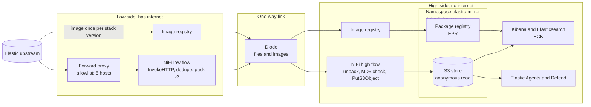

# 1. Architecture

A stack that cannot reach the internet still fetches content from Elastic at runtime.
The package registry is one of seven sources.

| # | Content | Upstream host | Consumer setting |
|---|---|---|---|
| 1 | Integrations and the detection rules package | `epr.elastic.co` | Kibana `xpack.fleet.registryUrl` |
| 2 | Agent, fleet-server and endpoint-security binaries | `artifacts.elastic.co` | Fleet "Agent binary download" source |
| 3 | Elastic Defend artifacts | `artifacts.security.elastic.co` | Defend `<os>.advanced.artifacts.global.base_url` |
| 4 | GeoIP databases | `geoip.elastic.co` | Elasticsearch `ingest.geoip.downloader.endpoint` |
| 5 | ML models (ELSER, e5, rerank) | `ml-models.elastic.co` | Elasticsearch `xpack.ml.model_repository` |
| 6 | AI Assistant knowledge base | `kibana-knowledge-base-artifacts.elastic.co` | Kibana `xpack.productDocBase.artifactRepositoryUrl` |
| 7 | Container images | `docker.elastic.co` | Image references in your manifests |

## Design

The low side only downloads. The high side only serves. One-way transfers carry the bytes
between them. Nothing is built, rewritten or repackaged on the way, so a file in the high
side store is the upstream file.

## Two paths

| Path | Carries | How |
|---|---|---|
| Images | The package registry image, one per stack version | Registry mirror copies it by digest across the link. See [04-transfer.md](04-transfer.md) |
| Files | Items 2 to 6 above, about 2.9 GiB for one stack version | NiFi `InvokeHTTP`, FlowFile v3 pack, diode, unpack, `PutS3Object` |

## High side serving

- An EPR container (`package-registry/distribution`) answers the Fleet catalogue.
- An S3-compatible store holds every raw file. It allows anonymous read and returns each
  object's MD5 as its `ETag`, which Elastic Endpoint requires.
- Both run in one namespace with a default-deny `NetworkPolicy`. They have no route out.
  Only the Elastic namespaces, the ingress controller and the high-side NiFi may reach them.
- Writes use a separate write-only store user. The admin key stays inside the namespace.

## Store layout

| Bucket | Prefix | Content |
|---|---|---|
| `elastic-mirror` | `downloads/beats/elastic-agent/`, `downloads/fleet-server/`, `downloads/endpoint-dev/` | Agent binaries with `.sha512` and `.asc` |
| `elastic-mirror` | `downloads/GPG-KEY-elastic-agent` | Agent upgrade key |
| `elastic-mirror` | `downloads/endpoint/` | Defend manifest zip and artifacts |
| `elastic-mirror` | `geoip/` | `overview.json` and the three `.tgz` databases |
| `elastic-mirror` | `models/` | `.metadata.json`, `.pt` and `.vocab.json` per model |
| `elastic-kb` | root | Knowledge base zips. The store's bucket listing is the `index.xml` Kibana reads |

## Why a file store and no web server

A static store with S3 semantics needs no build step on the high side. The same
`PutS3Object` that writes a file also fixes its `ETag`, because a single-part PUT makes the
`ETag` the object's MD5 in hex. A web server needs a config that rewrites its own `ETag`
(nginx adds a dash) and a volume that something else must fill.
